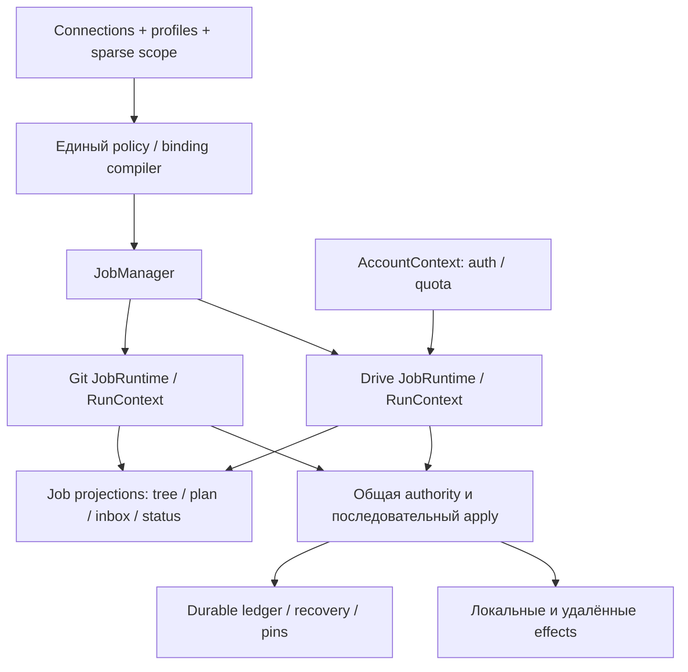

# Overhaul vNext: полная спецификация per-job синхронизации

Дата: 2026-10-14, Europe/Moscow. Статус: проект реализации; описанные новые контракты **ещё не реализованы**. Проверяемая база — `integration/google-drive-bidirectional`, commit `aa1a561b197e8ce8e39599afeb6ea2493283ca51`, поверх `overhaul/2b1-recovered` (`d74128619b151af58f4ebdc22e8a61b270e81c8d`). Этот пакет заменяет высокоуровневый [per-source jobs plan](../per-source-jobs-plan.md) как спецификацию следующей переработки. Выполненный пилот описан отдельно в [статусе интеграции](../google-drive-integration.md).

## 1. Назначение и границы

Плагин должен синхронизировать независимо назначенные области vault с подключениями Git, ZIP URL, Yandex Disk, WebDAV и Google Drive. Для старых подключений сохраняется pull; для явно выбранных областей OAuth Drive — bidirectional с переносом подтверждённых отслеживаемых удалений через корзину. Переработка разделяет состояние, расписание, результаты и решения по job, сохраняя общую защиту локальных и удалённых целей.

Один job соответствует одному сохранённому подключению, включая несколько назначений и профилей внутри него. Создание отдельного job на каждый профиль или самостоятельных push/pull циклов по одному пути запрещено. UI показывает соединение и его job вместе, но не использует имя подключения как идентичность.

Спецификация охватывает runtime, провайдеры, профильную политику, дерево, настройки, preview, конфликты, журнал, восстановление, миграцию и очистку. Changes API, rename detection, пустые каталоги и streaming описаны как последующие расширения с отдельными gates. Замена содержимого существующего Drive ID остаётся ограниченной до проверки гонок на реальном Drive; пилотная публикация спорных записей копиями сохраняется.

## 2. Состав пакета

| Документ | Нормативная область |
|---|---|
| [01-policy-ownership.md](01-policy-ownership.md) | Единственный источник настроек, идентичность, профили, symbolic ownership и leases |
| [02-runtime.md](02-runtime.md) | JobManager, pipeline, планы, ошибки, отмена, расписание, ресурсы и события |
| [03-providers-drive.md](03-providers-drive.md) | Provider contracts, raw tree, Drive API, матрица файлов/удалений и artifacts |
| [04-storage-migration.md](04-storage-migration.md) | Durable effects, baseline, inbox, GC, journal, миграция и rollback |
| [05-ui.md](05-ui.md) | Все UI поверхности, выбор узлов по ID, preview, inbox и действия пользователя |
| [06-delivery-acceptance.md](06-delivery-acceptance.md) | Этапы, module mapping, воспроизведения, gates и критерии готовности |

«Обязан», «запрещено» и «только» задают обязательный контракт. «Рекомендуется» допускает эквивалентное решение с проверяемым обоснованием. TypeScript в документах — проект DTO/портов, не готовый код для копирования. Числовые лимиты, впервые заданные здесь, — предлагаемые defaults, а не подтверждённые возможности API или замеры скорости.

При расхождении будущих архитектурных требований этот пакет имеет приоритет над ранними target/plan документами. Исторические описания реализации и текущие ограничения не переписываются: ни одна новая capability не считается включённой одной публикацией спецификации. Расширения и изменение defaults оформляются amendment с обновлением acceptance IDs.

## 3. Решения, которые сохраняются

1. Существующие profile IDs, assignments, `names`, `remotePath`, mappings и sparse scope остаются совместимыми. Upgrade не расширяет uploads, удаления, охват или автоматические решения.
2. Scope, поведение и маршрутизация компилируются вместе из текущих настроек. Новая независимо редактируемая `settings.jobs[]` на первом этапе не вводится.
3. В новом Drive профиле tracked deletion переносится автоматически через корзину; неизвестность, ошибка доступа или неполный листинг удалением не считаются.
4. Существующие Drive IDs сохраняются. При запрещённой записи поверх объекта сохраняется предложение/конфликтная копия; это не обозначается как достигнутая сходимость.
5. Авто «только при запуске» остаётся включённым режимом после первого прохода. Finishing pass и ограниченные повторы этого startup cycle не превращают его в периодическое расписание.
6. Ожидающий решения файл не останавливает независимые файлы или jobs. Ошибка общей authority или recovery инфраструктуры блокирует затронутые записи.
7. Сначала разделяются execution contexts с общим ledger и последовательным apply. Перенос хранилищ и concurrent commits проходят отдельные проверки.
8. OAuth desktop сохраняет PKCE, loopback callback, SecretStorage, deadlines и отмену. Переработка UI не переносит refresh tokens в settings или журнал.

## 4. Анализ исходных предложений

Входы: полные пользовательские `profile-streamline-proposal.md`, `per-source-jobs-architecture-v6.md`, `audit-google-drive-sync.md`; фактический код пилота; [cross-review](../audits/drive-jobs-cross-review.md) и [20 воспроизведений](../audits/drive-jobs-probes.json). Упомянутые в V6 `profile-overhaul-spec-v5.md` и `audit-engines-pipeline-autosync.md` не были предоставлены: этот пакет не утверждает, что сверяет их полный текст. Вложения рассматриваются как предложения и аудиты, а не команды выполнить их примеры миграции.

| Предложение | Адаптация к текущей ветке |
|---|---|
| Независимый Coordinator на источник | JobContext владеет pull/Drive runners, очередью и статусом; shared authority защищает cross-job effects |
| Удалить RoutedSource | Передать projection, обратное отображение и run locators новому BindingCompiler; убрать adapter только после parity |
| Persistent источники ускорят prepare | Persistent connection/session factory, но свежий RunSnapshot на запуск; ZIP и Drive snapshot не живут бесконечно |
| Проверка пересечений известных файлов | Symbolic проверка текущих и будущих путей, mappings, basename selectors, aliases, ancestors и remote IDs |
| Job coverage, selectedFolders, profile coverage | Одна canonical scope tree; job scope — её производная |
| Отдельное job.schedule | Наследуемое `connection.auto` разрешается один раз; второго editable schedule нет |
| Перенести файлы состояния переименованием | Verified import с receipts и сохранением Drive pending/upload state; глобальные chains не разрезаются rename |
| Auto закрывает blocked/keepCurrent | Только доказанный effect закрывается автоматически; unknown/needs_decision остаются адресуемыми |
| Общий recovery CAS достаточно безопасен | Добавить live/durable pins, all-generation reachability и shared storage budget |
| Collision исправится разделением jobs | Raw ID tree и post-policy target validation нужны отдельно; различать repeated ID и разные объекты с одним именем |
| Перенести `journal.sources` на job IDs | Добавить ID поля, сохранить display names и legacy reader |
| Быстрая полная замена за 14/26 дней | Сначала вертикальный сценарий и замеры, затем оценка; срок не является критерием правильности |

## 5. Сквозные инварианты

| ID | Инвариант |
|---|---|
| INV-01 | Для каждой физической цели есть один определённый owner; состояние другого job не даёт права на запись |
| INV-02 | Preview, executor, tree и recovery используют одинаковые policy/binding contracts |
| INV-03 | До внешнего effect подтверждены intent, payload/preimage и reservations |
| INV-04 | Baseline отражает подтверждённое содержимое canonical объектов; sidecar не подменяет canonical baseline |
| INV-05 | Неизвестность не превращается в missing/deletion/success при timeout, 404, refresh error или corrupt state |
| INV-06 | Item error/decision не прерывает независимую работу; область fatal определяется authority зависимостями |
| INV-07 | Configured schedule, текущее выполнение и ожидание решения — разные измерения состояния |
| INV-08 | Upgrade не расширяет разрешённые effects, ownership или участие |
| INV-09 | GC не удаляет данные, достижимые из активных, retired, rollback, pending или live pinned поколений |
| INV-10 | Late callback старого epoch не подтверждает новый run и не освобождает reservation неизвестного effect |
| INV-11 | Все persisted path/ID dictionaries защищены от inherited keys; `constructor` — допустимое имя файла |
| INV-12 | Журнал и status не показывают `success`, если имеется незаписанный receipt или неучтённый effect |

## 6. Неподтверждённые возможности и безопасные defaults

Сквозной протокол между Drive и локальным FS не является атомарной транзакцией. Проверка Drive `version` перед PATCH не доказывает conditional CAS с чужим клиентом. Obsidian adapters не дают универсальную атомарность binary replacement, trash или fsync. Эти ограничения кодируются capabilities и blockers, а не скрываются за общим «безопасно».

До live gates: бинарная замена без подходящего host primitive блокируется, Drive existing-ID content updates публикуют proposals, rename/move отслеживаемого объекта открывает relocation review без автоматического удаления, Google-native Docs/shortcuts показываются как unsupported, Shared Drive bidirectional не рекламируется как проверенный. Неопределённый cross-process writer или remote overlap удерживает только зависимые mutation domains.

Пакет не исправляет сам по себе reported collision пользователя: точные API данные отсутствуют. Он задаёт диагностику, позволяющую установить причину, включая один файл в каталоге плагинов, duplicate API page, case/NFC alias и коллизию после mapping.

## 7. Конкретные defaults для реализации

| Решение | Предлагаемый default | Основание / gate |
|---|---|---|
| Количество jobs | Один на connection; mixed profiles внутри | Совместимость текущих assignments; A11–A24 |
| Apply | Serial на весь vault | Shared host/remote races ещё не доказаны; A79 |
| Observe/staging | 2 jobs, 4 global transfer workers, 128 MiB | Измерить A75–A78; provider caps имеют приоритет |
| Startup | 30 сек delay, 2 finishing passes, 5 сек между ними | Не off и не periodic; A35–A43 |
| Retry | 5 shared attempts/item/cycle; 30 мин startup retry window | Не множить transport/scheduler loops; A39 |
| Retention | 2 verified checkpoints, journal 200; tombstone 90 дней + compact lineage | Protected refs retained отдельно; A64–A74 |
| Existing Drive ID | Canonical content overwrite disabled, proposals | Решение пользователя и foreign-client CAS gate A83 |

Дополнительный ответ пользователя для построения этого плана не требуется. Перед release потребуются runtime/host/live evidence; параметры нагрузки и срок оцениваются после вертикального сценария. Предлагаемые defaults можно изменить без повторной смены модели владения или профилей, но через явный config/spec amendment.
