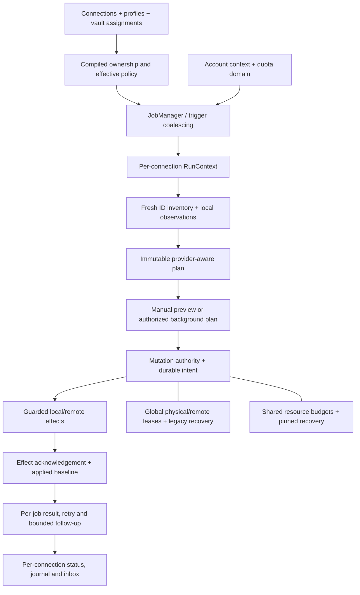

# Per-source jobs: исправленный план интеграции в overhaul

Дата: 2026-10-14, Europe/Moscow. Основание — критическая [сверка Drive-аудита и V6](audits/drive-jobs-cross-review.md), текущий runtime `028215b`, ранее принятые [profile streamline](profile-streamline-integration.md) и [Drive target](google-drive-bidirectional-spec.md). Это план следующей реализации, а не описание уже включённого JobManager.

## 1. Принятые решения

- Независимый runtime job для подключения; per-job progress, retry, blocked state, scheduler и run ownership.
- Сохраняем Connections, profile library и один глобальный compiler assignments/participation/routing. Runtime jobs строятся из них; отдельная конкурирующая settings.jobs конфигурация не вводится на первом этапе.
- `inherit` остаётся каноническим input настройки, а действующий SchedulerInterval вычисляется отдельным resolver; невалидное значение отклоняется до создания таймера.
- Профиль по умолчанию и более точные per-path overrides допустимы. Direction/effective behavior разрешаются для каждого пути; один OAuth connection может содержать pull и bidirectional области.
- 0 или 1 default source. Disabled/failed default не отдаёт свои пути другому источнику автоматически.
- Auth lifecycle остаётся account/grant-level; source identity, data generation, run snapshot и конкретная операция отделены друг от друга.
- Ошибка файла/поддерева/job изолируется, если её границы доказаны. Global governance, общий недоступный диск/recovery и недостоверный общий mutation registry останавливают затронутые глобальные записи.
- На первом этапе application serial, независимые inventory/transfer staging можно распараллеливать после global budget. Concurrent mutation включается отдельным проверенным этапом.
- Shared recovery сохраняется с pin-aware GC. Раздельные journals — возможный storage backend позднего этапа, не обязательное условие job isolation.
- Existing Drive ID сохраняется; content update остаётся выключенным. Публикация конфликтного предложения не выдаётся за завершённое in-place обновление.

## 2. Runtime identities и responsibilities

| Понятие | Содержимое / жизненный цикл |
|---|---|
| ConnectionId / JobId | Стабильный ID из Connections; human name не identity; job ID не достаточен для reuse baseline |
| AccountContext / GrantRef | OAuth client, account sub, granted scopes, SecretStorage ref, token manager и quota/backoff domain; может использоваться несколькими jobs |
| PairIdentity | Actual remote root ID/principal и compiled routing конкретной локальной области. Изменение account/root/семантического mapping создаёт другую data generation |
| PolicyRevision | Behavior/participation/protection/config revision. Изменяет разрешённый plan, но не сбрасывает baseline только потому, что изменился conflict preset |
| RunSnapshot | Свежий bounded inventory, observed local versions, source evidence и leases на provider resources; не живёт бесконечно вместе с connection |
| JobRuntime | Queue, per-job schedule/block state, active RunContext, last attempt/last acknowledged success, текущая generation |
| OperationId / ProposalId | Durable identity конкретного эффекта/конфликтного предложения. Повтор после unknown result использует тот же reserved resource identity |

Архивные generations остаются доступными recovery/ownership registry. Смена root/mapping не удаляет их автоматически и не переносит старую очередь в новую pair по одному path. Credential rotation обновляет account transport с epoch fence и повторной проверкой principal; произвольное изменение source.values не считается безопасной ротацией.

## 3. Target flow

Жизнь durable intent длиннее жизни RunContext. Cancellation отменяет не начавшиеся операции и ждёт settlement начатого host effect. Job нельзя объявить завершённым, dispose/rebuild или передать его targets другому владельцу до известного settlement либо сохранения unresolved reservation.

## 4. Inventory и collision contract

Для Drive нужны отдельные `browseInventory` и `executionProjection`. Raw objects имеют `id`, `parentId`, `name`, `mimeType`, version, root membership и availability. Display path — производная; два ID могут иметь одинаковый path.

Browse отображает ambiguous/unsupported/protected объекты, а не падает целиком. UI различает object identity и выбранный local destination. Для записи projection применяет выигравшие assignments, participation, names filters, capability и hard protection. Неразрешимая collision блокирует соответствующий target или subtree; destructive inference запрещён также для descendants blocked subtree.

Повтор ID с теми же данными — повторное наблюдение, а не обязательно два файла. Повтор с другим parent/version/name — нестабильный inventory; допускается ограниченная пересверка. Cycle/вне-root locator блокируется. Нельзя «починить» collision выбором первого ID, global lowercase rename или удалением одного объекта.

Diagnostics record должен содержать kind, source/job, stage, path, object IDs, parent IDs и причины exclusion. Он не содержит grant/session URLs, bytes файлов или credentials. Connection test, tree browse и sync preflight должны выдавать согласованный тип проблемы, а не только одинаковую строку.

## 5. Ownership и mutation authority

Владение рассчитывается символически, включая ещё не созданные пути. Сохраняются приоритеты exact-file/deepest-folder/name-filter и sparse include/exclude/inherit. Валидация расширением папок по текущим файлам недостаточна.

Record keys пользовательских путей/ID не должны читать inherited Object properties. Проверяются extensionless `constructor`/`__proto__`, обычные plugin-файлы, case/NFC aliases и неизвестные schema fields. Это свойство storage/validation, а не запрет допустимых имён файлов.

Mutation authority проверяет:

- текущего владельца canonical physical destination, file/directory ancestors, from/to rename и область policy revision;
- unresolved reservations всех активных, отключённых, retired jobs/generations и legacy ledger;
- runtime package dependencies `.obsidian/plugins/<id>/{main.js,manifest.json,styles.css}` и общих родителей;
- remote writable overlap: два локально независимых jobs могут обращаться к одному Drive ID/root;
- наличие capability конкретной записи, immutable payload/recovery pins, latest versions и действующих глобальных gates.

Локальный lease и journal intent связываются до изменения файла. Unknown result удерживает target; automatic repair может закрыть только доказанный applied/not-applied эффект. Смена ownership — staged transaction с fencing old run, а не автоматический keepCurrent.

Общий registry в пределах одного экземпляра плагина не даёт гарантий против чужого приложения, другого процесса или стороннего клиента Drive. Host CAS и remote API preconditions должны отражать реальные возможности; отсутствие атомарного primitive приводит к blocked/copy path, а не к обещанию безопасной last-writer-wins записи.

## 6. Scope ошибок, успех и retry

| Область ошибки | Пример | Реакция |
|---|---|---|
| File | checksum mismatch, local changed, denied конкретного файла | Guard/replan или bounded file retry; независимые targets продолжаются |
| Subtree | неоднозначный parent/destination | Block descendants, показать resolution; не использовать как missing inventory |
| Job/root | недоступен выбранный root, неизвестна data generation | Приостановить эту pair; чужие доказанно независимые jobs продолжаются |
| Account/provider | invalid grant, account quota/cooldown | Приостановить jobs данного grant/account; Git другого провайдера продолжает |
| Shared storage | disk full, recovery quota, недостоверный registry | Остановить затронутые mutations, сохранить unknown effects и диагностировать общий ресурс |
| Global access | VAM/governance/revocation | Остановить новые действия всех jobs и fence late responses |

Один строковый blockedReason нельзя снять кнопкой без проверки устранения причины. После repair выполняется fresh preflight/targeted probe. Retry имеет budgets по request, operation, account и startup job; due paths выбираются явно. Несколько connections одного Google account не получают независимую реальную API-квоту.

Результат job различает applied work, pending decisions, unknown absence, deferred retries, blocked scope, cancelled и failed. Счётчики выводятся из unique operation/proposal IDs, а не суммирования нескольких фаз по одному path. Last successful sync обновляется после durable acknowledgement и required persistence, не только после завершённого download. Общий batch может быть partial: healthy jobs completed, другие needs_attention; общий зелёный статус запрещён при скрытой незавершённой работе.

Startup-only — один стартовый job с ограниченными продолжениями и сверочным проходом, без постоянного наблюдения после завершения. Total elapsed/retry deadline показывается явно. Rebuild не должен повторить уже завершённый startup только потому, что создан новый Scheduler object.

## 7. Conflict artifacts, unknown absence и user decisions

Копия Drive — самостоятельный синхронизируемый объект с parent/original item/proposal/content identity, а не файл, навсегда исключённый по regex. Legacy private recovery и pull sidecars остаются отдельными категориями; hard protected paths сохраняются.

Lineage metadata должна работать на втором устройстве и при поддерживаемой смене OAuth app. Одних private appProperties может быть недостаточно. Metadata не даёт права перезаписать совпавший пользовательский файл: ownership, ID, content и scope проверяются отдельно. Схема должна укладываться в лимиты Drive custom properties.

Proposal history содержит каждую сохранённую версию; новая правка не уничтожает ссылку на прежний review. Обычный retry не создаёт второй object. Repeated content/version proposal проверяется через lineage и hashes. Детерминированное имя без этой проверки недостаточно.

Для `404/unavailable/scope_exit` нужна persistent inbox с понятной причиной и решениями: сохранить локальную версию с явным ack/protection, выбрать новый remote locator, создать новый удалённый объект при новой явной авторизации либо удалить локальную копию через корзину после свежей проверки и подтверждения. Ошибка доступа не превращается в deletion по TTL. Предложенные действия обязаны уважать existing-ID update gate.

Keep-resurrection, ask/manual и невозможность binary CAS объясняются непосредственно в состоянии конкретного файла. После решения пересматриваются текущие object/local versions; старый consent не используется для изменённого содержания.

## 8. Source lifecycle и storage

ConnectionContext можно хранить долго; RunSnapshot имеет ограниченную lease/freshness. Для Git можно использовать ETag/immutable SHA, для ZIP — согласованный reader с проверяемой version, для Drive — graph/cursor, для Yandex — endpoint-specific href freshness. Persistent source не означает reuse старого inventory без проверки.

Reload: stop new triggers → cancel/join old run → persist settlement → validate new generation/ownership → install new context → activate schedules. Таймеры стартуют после общего config validation. Disable/delete сохраняют recovery и retired reservations; очищают live credential refs только после проверки других consumers. OAuth revoke — отдельный наблюдаемый account action.

Shared recovery получает live pins с момента получения/создания payload до durable publication. GC выполняется по согласованным refs всех retained stores и pins, включая inactive generations. Дедупликация старого payload не обходится проверкой «файл недавно создан».

На тёплом Drive no-op baseline не сохраняется заново. Изменения item state пишутся deltas или группами с обязательными acknowledgement boundaries после effects. Retention bounded; unknown future/corrupt metadata не удаляется как мусор. Job-level quota дополняет общий storage budget, не заменяет его.

## 9. Миграция

Первый job refactor работает с действующими settings и shared ledger, без переименования файлов. Затем storage migration выполняется отдельно:

1. Остановить и fence writers; прочитать/проверить все retained legacy states и сохранить исходный backup.
2. Определить owner каждого baseline/pending effect по recorded namespace/identity. Неоднозначные записи сохраняются в legacy recovery domain с защищённым target.
3. Создать новые verified stores с rewrite содержимого identity/refs и migration receipts. Перенос manifest требует изменения `sourceId`, а не только filename. Полную глобальную checksum/event chain нельзя разрезать переименованием.
4. Перенести **Drive baseline, pending, reviews и reserved upload IDs/offsets**, а также failed queues и applied local bases. Если новую identity доказать нельзя, выполняется non-destructive reconciliation; старый state сохраняется.
5. Проверить roundtrip settings/scope/policy и отсутствие новых upload/delete разрешений; ack сохранения settings и active-generation switch.
6. Использовать versioned marker, который старые readers не интерпретируют как пустую новую историю. Rollback выполняется через поддержанный importer/reconcile, не запуск старой сборки поверх неизвестного remote pending.
7. После повторного запуска сверить receipts и refs; только затем разрешить pin-aware cleanup завершённых legacy generations.

Глобальный ledger registry и FS publication не имеют fsync гарантий автоматически. Crash matrix должна проверять каждую границу migration и сохранять старую рабочую либо новую verified конфигурацию; смесь без owner evidence блокирует writes.

## 10. Порядок внедрения и acceptance gates

| Этап | Конкретный результат | Gate |
|---|---|---|
| 0: исправления текущего Drive | Collision diagnostics/ID browse design, видимость artifacts, unknown/review inbox, no-op state fix и уникальные counters | Один plugin-файл проходит; repeated ID не выдаётся за второй файл; no-op не пишет baseline; второй vault видит copy |
| 1: authority contracts | Symbolic owner resolver, pair/generation identity, persisted physical/remote reservations и типизированные errors | Nested overrides/future files/aliases/retired targets/remote overlap проверены до writes |
| 2: independent contexts | Per-connection RunContext/queue/block status и inert JobManager, shared ledger; application serial | Drive failure не блокирует Git, но не передаёт ему Drive scope; fatal shared state блокирует все соответствующие writes |
| 3: unified planning и UX | Provider-aware immutable plans, Drive upload/trash/copy preview, targeted decisions и account lifecycle | Preview совпадает с effects; stale consent не применяется; существующие ID не заменяются |
| 4: storage cutover | Verified per-job backend, receipts/dual readers/rollback fences, pin-aware GC | Crash на каждом шаге migration, all-generation recovery references и повторное включение old build не теряют history |
| 5: throughput | Global memory/account quota gates, bounded parallel staging; затем разрешённые concurrent commits | Same parent, package split, GC/save, alias, ownership transfer и account cooldown races проходят |
| 6: live Drive и release | Two-vault/device tests, API capabilities, permission loss/trash/concurrent client tests и real benchmark | Только после результатов расширяется existing-ID write capability; отдельные Shared Drive/mobile ограничения остаются явными |

Changes API, rename identity, empty directories и streaming продолжают Drive target plan; jobs не заменяют эти этапы. Старые input/recovery readers сохраняются в пределах поддерживаемых схем. Удаление RoutedSource выполняется, когда routing/projection/locator обязанности переданы и эквивалентность доказана; временный compatibility adapter допустим.

До унификации operation protocol job использует совместимый pull runner и Drive runner с отдельным Drive baseline; оба получают один JobContext/authority и выполняют строго свои выигравшие direction scopes. Этот compatibility шаг не является независимыми push/pull loops по одному пути и не меняет bidirectional на pull при миграции.

Оценка 14/26 рабочих дней из V6 не принимается как срок. Следующая практическая единица работы — вертикальный сценарий «один Drive job с collision/inbox и один независимый Git job», проверенный на host и crash/failure fixtures; после него можно оценивать следующие этапы.
